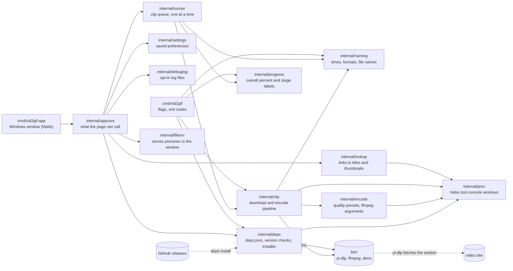
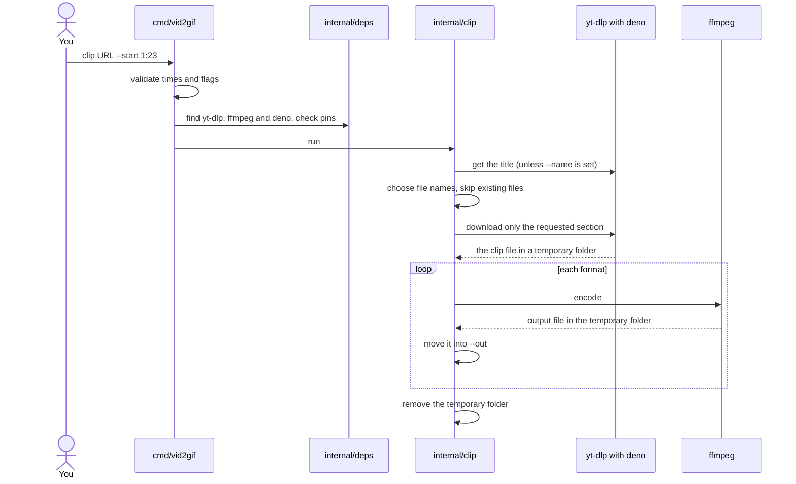

# vid2gif

vid2gif cuts a segment out of an online video and saves it as a GIF, an animated WebP, an MP4, a MOV, or any mix of those. Give it a link and a start time (an end time is optional), and pick where the files go.

[yt-dlp](https://github.com/yt-dlp/yt-dlp) fetches just the part of the video you asked for, and [ffmpeg](https://ffmpeg.org) turns it into the output format. YouTube also needs a JavaScript runtime, which is [deno](https://deno.com). vid2gif runs all three and keeps them at pinned versions, so your results don't change when one of them updates.

Supported platforms: Windows (amd64) and Linux (amd64, arm64). The desktop app is Windows only.

## Quick start

You need [Go](https://go.dev/dl/) 1.26.2 or newer to build it. You don't need yt-dlp, ffmpeg or deno installed; vid2gif fetches its own copies.

```powershell
go build -o vid2gif.exe ./cmd/vid2gif   # produces vid2gif.exe on Windows
./vid2gif deps install            # one-time: downloads the pinned yt-dlp, ffmpeg and deno into bin/ (or $VID2GIF_BIN)
./vid2gif clip "https://www.youtube.com/watch?v=aqz-KE-bpKQ" --start 2 --end 5
```

That writes `gifs/<video title>_2-5.gif`. Keep `deps.json` in the same folder as the executable, because that's where vid2gif looks for it (if it isn't there, the current folder is used, which is what makes `go run ./cmd/vid2gif` work from the repo root).

## Desktop app

If you'd rather not use a terminal, there is a Windows app: paste a link, pick the moment you want, and it makes the GIF (or WebP, MP4 or MOV) for you. It uses the same engine as the command line, so the files come out the same.

- **Download:** the [releases page](https://github.com/noktoa/vid2gif/releases) has an installer, `vid2gif-<version>.msi`, and the plain `vid2gif-app.exe`, a single file you can run from any folder. On current Windows 10 and 11 neither needs anything installed first (the window uses WebView2, which comes with Windows).
- **Helper tools:** yt-dlp, ffmpeg and deno (about 250 MB) are downloaded during install. If that step couldn't run (for example you were offline), or you use the plain .exe, the app downloads them on first launch and shows a progress screen while it does. It only happens once.
- **Where things live:** your settings, logs and the app's web view data are in `%LOCALAPPDATA%\vid2gif`. The helper tools are in a `bin` folder next to the app. (Set `VID2GIF_BIN` to put them somewhere else, as with the command line.)
- **If something goes wrong:** turn on Settings → Troubleshooting. The app then writes one log file per run to `%LOCALAPPDATA%\vid2gif\logs` and keeps the newest 5. The log includes the video links you used, so look through it before you send it with a bug report.
- **Windows only.** The Linux build is the command line.

### Installing with the MSI

1. Run `vid2gif-<version>.msi`. The installer isn't code-signed, so Windows SmartScreen may say it "protected your PC". Click **More info**, then **Run anyway**. (Signing costs money every year, and this app is shared among friends.)
2. Choose **Install just for you** (the default, no administrator rights needed) or **Install for all users of this machine** (Windows asks for an administrator).
3. Keep the suggested folder or pick your own. Just for you installs to `%LOCALAPPDATA%\Programs\vid2gif`, for all users to `C:\Program Files\vid2gif`.

The installer adds a Start Menu shortcut and an entry in Settings → Apps → Installed apps, then downloads the helper tools into `<install folder>\bin`. An all-users install has one shared copy of the tools that only administrators can change. If a standard user is ever told the helper files couldn't be set up, an administrator can run **Repair** on vid2gif in Installed apps. Installing a newer MSI upgrades in place and keeps the tools and your settings.

**Uninstalling** (from Installed apps) removes the program, the shortcut, the helper tools vid2gif put in `bin` (and any half-finished download of them), and `%LOCALAPPDATA%\vid2gif` (settings, logs, web view data). Only the app's own files are removed: `bin` and the install folder go only when nothing else is left in them, so other files in a folder you already had stay. In a `bin` folder only three files are ever touched: `yt-dlp.exe`, `ffmpeg.exe` and `deno.exe` (installing replaces them if they are not the pinned versions, and uninstalling removes them). It never removes the clips you made or your output folder. If a clip was interrupted by a crash, a `.vid2gif-tmp-*` folder may be left in the output folder; it is safe to delete.

For an all-users install, uninstalling clears `%LOCALAPPDATA%\vid2gif` only for the user who runs the uninstall. Other people who used the app on that PC can delete their own `%LOCALAPPDATA%\vid2gif` folder.

To build the MSI you need the [WiX Toolset](https://wixtoolset.org) 6 and its UI and Util extensions:

```powershell
dotnet tool install --global wix --version 6.0.2
wix extension add --global WixToolset.UI.wixext/6.0.2 WixToolset.Util.wixext/6.0.2
wix build installer\vid2gif.wxs -ext WixToolset.UI.wixext -ext WixToolset.Util.wixext -arch x64 -d Version=0.1.0 -d AppExe=dist\vid2gif-app.exe -o dist\vid2gif-0.1.0.msi
```

`installer\test.ps1` builds two versions, then installs (just for you, into a temp folder), upgrades and uninstalls, and checks what is left. It refuses to run if vid2gif is already installed, and it moves your `%LOCALAPPDATA%\vid2gif` aside while it runs and puts it back afterwards. It downloads the helper tools once.

To build it from source you need Go, and nothing else:

```powershell
go build -trimpath -tags desktop,production -ldflags "-H windowsgui -s -w" -o dist/vid2gif-app.exe ./cmd/vid2gif-app
```

The page inside the app is plain JavaScript in `cmd/vid2gif-app/frontend/`. Its tests need Node.js 22 or newer:

```
node --test "cmd/vid2gif-app/frontend/*.test.js"
```

`vid2gif-app.exe --install-tools` downloads the helper tools without opening a window (the MSI runs it). It writes a log to `%TEMP%\vid2gif-install.log`. For an all-users install the MSI runs it as the system, so that log is in the system's temp folder (`C:\Windows\SystemTemp` on current Windows 11, `C:\Windows\Temp` on older versions), not your own `%TEMP%`.

## Examples

```
# A GIF from 1:23 to the end of the video (no --end means until the end)
vid2gif clip "https://example.com/watch?v=abc" --start 1:23

# A GIF and an MP4 of the same moment, in a folder of your choice, with your own file name
vid2gif clip "https://example.com/watch?v=abc" --start 1:23 --end 1:30 --format gif,mp4 --out D:\clips --name highlight

# A small, rough WebP
vid2gif clip "https://example.com/watch?v=abc" --start 90 --end 95 --format webp --quality low

# Fractional seconds work on the last part of a time
vid2gif clip "https://example.com/watch?v=abc" --start 1:23.5 --end 1:25
```

The URL always comes first, then the flags.

## Options

Run `vid2gif help` to see all of this in the terminal.

| Flag | Default | What it does |
|---|---|---|
| `--start T` | required | Where the clip begins. |
| `--end T` | the end of the video | Where the clip ends. Must be after the start. |
| `--format LIST` | `gif` | Any of `gif`, `webp`, `mp4`, `mov`, separated by commas. |
| `--out DIR` | `./gifs` | Where the files are written. The folder is created if it doesn't exist. |
| `--name BASE` | `<video title>_<start>-<end>` | File name without the extension. Each format adds its own. With no `--end` the end part is the word `end`, as in `title_83-end`. At `--quality low` or `high` the default name ends in `_low` or `_high` (`title_83-88_high`), so the same clip at another quality is a new file, not a skip. `medium` adds nothing. A name you give with `--name` is used exactly as typed. |
| `--quality Q` | `medium` | `low`, `medium` or `high`. See below. |
| `--overwrite` | off | Replace files that already exist. |
| `--full-source` | off | GIF and WebP only. Normally vid2gif downloads the smallest video at least as wide as the quality needs (320, 480 or 720 pixels), which is a smaller download and gives a GIF or WebP of the same size. This flag downloads the best video instead. MP4 and MOV always use the best video. |
| `--no-pin` | off | Skip the version check. The tools folder is still searched first, then your PATH. deno is optional here. |
| `--no-progress` | off | Don't draw the progress bar. |

Times are written as `SS`, `MM:SS` or `HH:MM:SS`. Only the last part can have decimals.

Without `--end` the clip runs to the end of the video. On a long video, give an end time unless you really want everything after the start, because a GIF of that much footage gets very large.

### Progress

In a terminal, `clip` shows one line that updates in place, with the same wording and numbers as the desktop app:

```
Getting the clip 63%    [█████████░░░░░░░░░░░░░░░]  41%
```

The percentage at the end is for the whole clip. It never reaches 100% before the clip is done and never goes backwards, and there is no time estimate. Making a GIF or WebP can't be measured, so during those steps a block moves along the bar instead of a number. Without `--end` the clip's length isn't known, so the bar only shows activity for the whole run. Outside Windows Terminal on Windows, or without a UTF-8 locale elsewhere, the bar is drawn with plain characters (`[#####-----]`).

While the bar is shown, yt-dlp's own messages are held back. If the run fails they are printed before the error, so you still see why. The `wrote …`, `skipped …` and `failed …` lines are printed as usual.

When the output isn't a terminal (redirected to a file, piped to another program, or sent to `NUL`), or with `--no-progress`, there is no bar and the output is the same as without the bar (before this feature).

### Existing files

If an output file already exists, vid2gif skips it, tells you, and carries on with the other formats. If every file you asked for already exists, it doesn't download any video (it still asks yt-dlp for the title unless you gave `--name`). Use `--overwrite` when you do want to replace them.

### Quality

| Preset | GIF and WebP frame rate | GIF and WebP max width | MP4 and MOV compression (CRF) |
|---|---|---|---|
| `low` | 10 fps | 320 px | 28 |
| `medium` | 15 fps | 480 px | 23 |
| `high` | 24 fps | 720 px | 18 |

GIFs and WebPs are resampled to the preset's frame rate (a source with a lower rate gets frames repeated), but the clip still plays at the same speed. Frames are dropped, not stretched. GIFs and WebPs are never scaled up, so a narrow source stays narrow. MP4 and MOV keep the original frame rate and size (rounded down to even numbers of pixels), and also keep the audio. GIF and WebP have no sound.

## Pinned dependencies

`deps.json` lists the exact yt-dlp, ffmpeg and deno builds vid2gif works with, for each platform: a download URL, a SHA-256 checksum and a version.

- `vid2gif deps install` downloads them into `bin/`, checks the checksums, and confirms each one reports the pinned version. If the right version is already there, it does nothing.
- Every `clip` run looks in the tools folder (`bin/` by default) first, then on your PATH, and compares the version with the pin before doing any work. If it doesn't match, vid2gif stops and tells you what it expected and what it found.
- `--no-pin` skips that check. It's also the way to use vid2gif on a platform that isn't supported yet, as long as you have your own yt-dlp and ffmpeg (and deno, for YouTube).

### Where the tools live

By default the tools go in `bin/`, next to `deps.json`. Set the `VID2GIF_BIN` environment variable to use another folder; both `deps install` and `clip` honour it. A relative path starts from the folder that holds `deps.json`, so `VID2GIF_BIN=bin` is the same as the default.

You can also put it in a `.env` file in that folder. `.env.example` shows the format, so `cp .env.example .env` is all it takes. A variable set in your real environment takes priority over `.env`. The integration test reads the same variable and the same file.

### When a download fails

Websites change, and a pinned yt-dlp will stop working on some of them sooner or later. When yt-dlp fails, vid2gif prints its error along with the pinned version. To move to a newer one:

1. Find the release you want on the [yt-dlp releases page](https://github.com/yt-dlp/yt-dlp/releases).
2. In `deps.json`, change the version, and the URL and SHA-256 for each platform. The checksums are listed in the release's `SHA2-256SUMS` file.
3. Run `vid2gif deps install`.

YouTube extraction needs a JavaScript runtime, so every `clip` run requires the pinned deno and stops with a `deps install` hint if it's missing or the wrong version. yt-dlp only uses the deno that vid2gif found (the pinned one, unless you pass `--no-pin`), never one it picks up by itself. See yt-dlp's [EJS page](https://github.com/yt-dlp/yt-dlp/wiki/EJS) for why. deno is bumped like the others: pick a release on the [deno releases page](https://github.com/denoland/deno/releases), copy its version, URL and the checksum from the `.sha256sum` file next to each zip into `deps.json`.

ffmpeg is bumped the same way, using the dated builds from [yt-dlp/FFmpeg-Builds](https://github.com/yt-dlp/FFmpeg-Builds/releases). Older dated builds are removed from that page over time, so if `deps install` reports a 404 for ffmpeg, pick a newer build.

The ffmpeg builds are GPL-licensed. vid2gif downloads them, and deno (MIT), when you run `deps install`; neither is included in this repository.

## Running the tests

```
go test ./...
```

runs the unit tests. They don't need yt-dlp, ffmpeg, deno or a network connection.

```
go test -tags integration -v -timeout 30m ./test/integration/
```

installs the pinned tools into a temporary folder and encodes real test videos to every format. The first run downloads about 250 MB.

To run the same test on Linux from a Windows machine, with Docker:

```
docker build --platform linux/amd64 -f build/Dockerfile.test -t vid2gif-test .
docker run --rm vid2gif-test
```

Use `--platform linux/arm64` for arm64. It runs under emulation and is slow.

The integration test installs the tools into a temporary folder unless `VID2GIF_BIN` is set (see [Where the tools live](#where-the-tools-live)); set it to reuse an existing folder such as `bin/` so nothing is downloaded again.

On GitHub, `.github/workflows/ci.yml` checks gofmt, runs `go vet`, the Go unit tests and the app's JavaScript tests on every push and pull request, and a second job builds the desktop app and runs the Go tests on Windows, then installs WiX and runs `installer\test.ps1` (which downloads the pinned tools). `integration.yml` runs the integration test on Windows, Linux amd64 and Linux arm64 every week and whenever `deps.json` or the code that uses it changes. The pinned tools are about 250 MB, so they're cached: the Linux jobs reuse Docker layers (`build/Dockerfile.test` puts the tools in their own layer, which only rebuilds when `deps.json`, `go.mod`, `go.sum` or the installer changes), and the Windows job caches the tools folder. The weekly run skips those caches so it still catches a pinned download that has been removed upstream. Neither workflow contacts YouTube; the integration and MSI tests only download the pinned tools from GitHub releases.

## Architecture

How the code is split up, and what talks to what:



Each package in one line:

- `cmd/vid2gif`: the command line: flags, exit codes.
- `internal/naming`: parses times and formats, builds output file names.
- `internal/deps`: reads `deps.json`, checks tool versions, downloads and verifies the tools.
- `internal/clip`: the download and encode pipeline for one clip.
- `internal/encode`: quality presets and ffmpeg arguments.
- `cmd/vid2gif-app`: the Windows desktop app. A thin Wails window over `internal/appcore`; `--install-tools` installs the tools headlessly.
- `internal/appcore`: the app's logic behind the methods the page calls (settings, lookups, runs, tool setup). It doesn't import Wails, so it is tested on Linux too.
- `internal/settings`: loads and saves the app's preferences.
- `internal/debuglog`: the opt-in diagnostic log, one file per run, with URLs scrubbed of anything that identifies you or signs a media request.
- `internal/lookup`: turns pasted links into videos with titles, durations and thumbnails, using one yt-dlp call per link.
- `internal/runner`: makes a queue of clips one after another and turns the pipeline's events into the states the app shows.
- `internal/progress`: turns the pipeline's stage events into one overall percent (from a table of measured stage costs) and the stage labels, for both the app and the command line.
- `internal/filesrv`: serves the generated previews to the app's window, only from allowed folders and only media files.
- `internal/proc`: stops tool child processes from flashing console windows when the desktop app starts them on Windows. From a terminal the tools share the terminal, so their output and Ctrl+C reach them.

What happens during one `clip` run:



The temporary folder is created inside `--out`, so the final move is a rename. `deps install` is separate: it downloads the three tools from GitHub releases, checks their SHA-256 hashes, and puts them in `bin/`.

## How it works

1. It checks your times and flags first, so a typo doesn't cost you a download.
2. It finds yt-dlp, ffmpeg and deno and checks their versions against the pins.
3. It asks yt-dlp for the video title (unless you gave `--name`), and works out which files it needs to write.
4. It downloads only the section you asked for, once, however many formats you want.
5. It encodes each format with ffmpeg and moves the result into your output folder.
6. It cleans up its temporary files, including when you press Ctrl+C. They live in a `.vid2gif-tmp-*` folder inside your output folder, so if the process is killed hard you can delete that folder.
