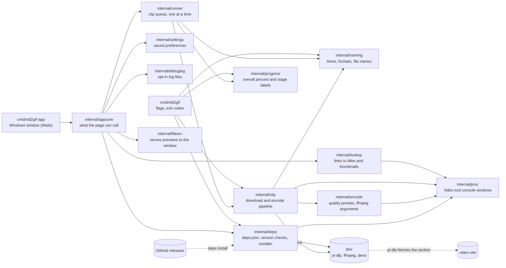
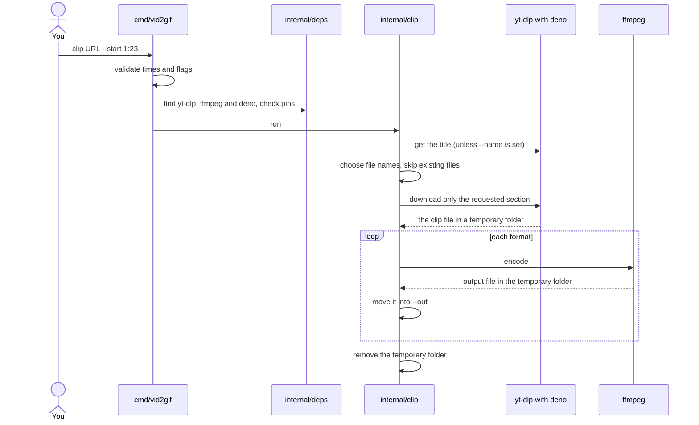

# Development

Build instructions: the CLI is in the [README](../README.md), the desktop app and MSI in [building.md](building.md).

## Tests

Unit tests need no yt-dlp, ffmpeg, deno or network:

```
go test ./...
```

The integration test installs the pinned tools into a temporary folder and encodes real test videos to every format. The first run downloads about 250 MB:

```
go test -tags integration -v -timeout 30m ./test/integration/
```

Set `VID2GIF_BIN` (see [Where the tools live](dependencies.md#where-the-tools-live)) to reuse a folder such as `bin/` so nothing is downloaded again.

To run it on Linux from a Windows machine, with Docker (use `--platform linux/arm64` for arm64; it runs under emulation and is slow):

```
docker build --platform linux/amd64 -f build/Dockerfile.test -t vid2gif-test .
docker run --rm vid2gif-test
```

## CI

`.github/workflows/ci.yml`, on every push and pull request:

- Job 1: gofmt, `go vet`, Go unit tests, the app's JavaScript tests.
- Job 2 (Windows): builds the desktop app, runs the Go tests, installs WiX and runs `installer\test.ps1`.

`integration.yml` runs the integration test on Windows, Linux amd64 and Linux arm64 every week and whenever `deps.json` or the code that uses it changes.

The pinned tools are about 250 MB, so they're cached: Linux jobs reuse Docker layers (`build/Dockerfile.test` puts the tools in their own layer, rebuilt only when `deps.json`, `go.mod`, `go.sum` or the installer changes), and the Windows job caches the tools folder. The weekly run skips the caches so it still catches a pinned download removed upstream. Neither workflow contacts YouTube; they only download the pinned tools from GitHub releases.

## Architecture



Notes beyond the diagram labels:

- `internal/appcore` has the app's logic behind the methods the page calls (settings, lookups, runs, tool setup). It doesn't import Wails, so it's tested on Linux too.
- `internal/debuglog` scrubs URLs of anything that identifies you or signs a media request.
- `internal/lookup` uses one yt-dlp call per link.
- `internal/runner` turns the pipeline's events into the states the app shows.
- `internal/progress` turns stage events into one overall percent (from a table of measured stage costs) for both the app and the CLI.
- `internal/filesrv` serves previews only from allowed folders and only media files.
- `internal/proc` stops tool child processes flashing console windows when the desktop app starts them. From a terminal the tools share the terminal, so their output and Ctrl+C reach them.

### One `clip` run



The temporary folder is created inside `--out`, so the final move is a rename. `deps install` is separate: it downloads the three tools from GitHub releases, checks their SHA-256 hashes, and puts them in `bin/`.
